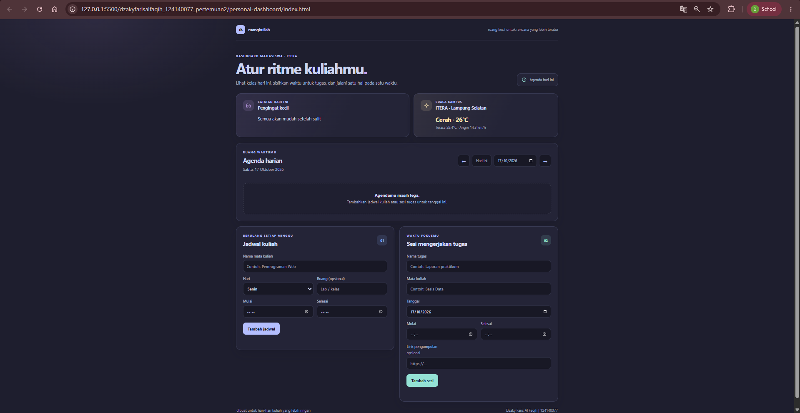
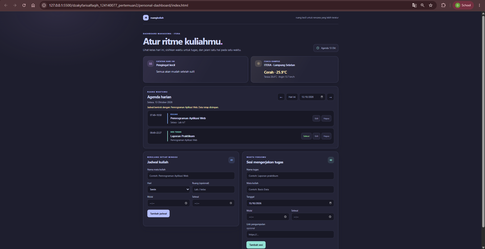
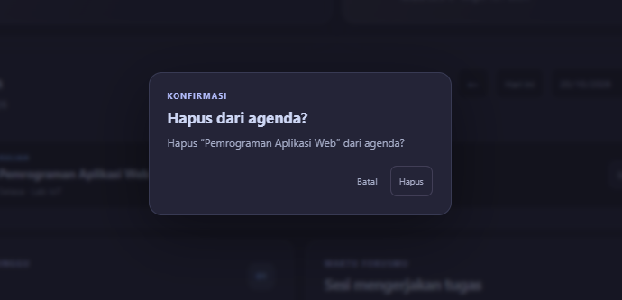
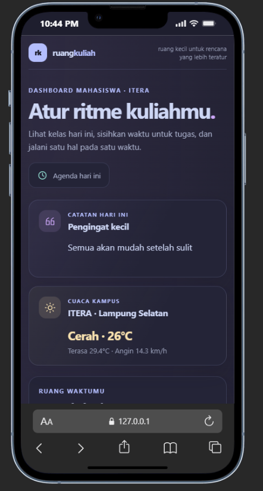

# Ruang Kuliah

Dashboard pribadi mahasiswa untuk melihat jadwal kuliah berulang setiap minggu dan merencanakan sesi pengerjaan tugas pada tanggal tertentu. Agenda mengikuti tanggal yang dipilih dan menampilkan jadwal kuliah pada hari tersebut.

## Fitur

- Tambah, edit, dan hapus jadwal kuliah mingguan.
- Tambah, edit, hapus, dan tandai selesai sesi tugas; link pengumpulan bersifat opsional.
- Navigasi agenda per tanggal dan peringatan bentrok waktu.
- Dialog konfirmasi sebelum jadwal atau sesi tugas dihapus.
- Simpan jadwal di `localStorage`, sehingga tetap tersedia setelah halaman dimuat ulang di browser yang sama.
- Kutipan pilihanmu “Semua akan mudah setelah sulit” selalu tampil apa adanya.
- Widget cuaca ITERA dari Open-Meteo menampilkan fallback jika API atau jaringan tidak tersedia; agenda tetap berfungsi.
- Tampilan responsif dengan palet Catppuccin Mocha.

## Menjalankan aplikasi

Buka folder ini di editor, lalu jalankan `index.html` menggunakan ekstensi Live Server atau server lokal lain. JavaScript memakai ES modules, jadi buka melalui `http://localhost` menggunakan Live Server, bukan URL `file://`.

## Screenshot

### Tampilan dashboard

Halaman utama pada layar desktop. Widget menampilkan catatan pribadi dan cuaca ITERA, sementara agenda kosong mengajak pengguna menambahkan jadwal.

### Agenda berisi jadwal dan sesi tugas

Contoh agenda yang sudah diisi. Jadwal kuliah dan sesi tugas tampil menurut waktu, termasuk peringatan ketika waktunya bentrok.

### Konfirmasi penghapusan

Dialog meminta konfirmasi dan menyebut nama item sebelum item tersebut dihapus.

### Tampilan mobile

Pratinjau tampilan responsif pada layar ponsel.

## Implementasi ES6+

Nomor baris mengacu pada file di folder `js/` dan dapat berubah jika kode diedit.

| Fitur | Lokasi kode |
|---|---|
| `let` untuk label agenda yang dapat berubah; `const` untuk nilai tetap | `js/dashboardApp.js:3-11`, `js/dashboardApp.js:279-280` |
| Arrow functions (helper, event listener, dan transformasi data) | `js/dashboardApp.js:13-25`, `js/dashboardApp.js:75-119`, `js/dashboardApp.js:266-276` |
| Template literals untuk pesan dinamis dan render agenda HTML | `js/dashboardApp.js:143`, `js/dashboardApp.js:235-236`, `js/dashboardApp.js:271-294` |
| Async/await untuk fetch cuaca dengan penanganan error | `js/dashboardApp.js:303-316` |
| Classes `TaskItem` dan `DashboardApp` | `js/taskItem.js:1-5`, `js/dashboardApp.js:27-318` |
| Destructuring parameter dan hasil form/API | `js/taskItem.js:2`, `js/dashboardApp.js:77-83`, `js/dashboardApp.js:309` |
| Spread operator dan pembaruan array immutable | `js/dashboardApp.js:136-137`, `js/dashboardApp.js:157-159`, `js/dashboardApp.js:191-193`, `js/dashboardApp.js:269-275` |
| Penyimpanan browser menggunakan `localStorage` dan JSON | `js/dashboardApp.js:52-70` |

