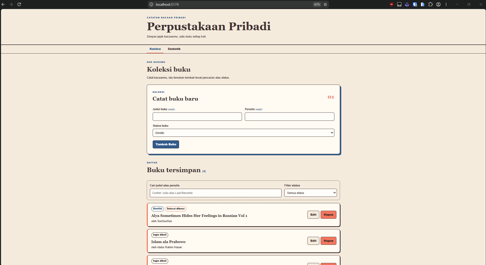
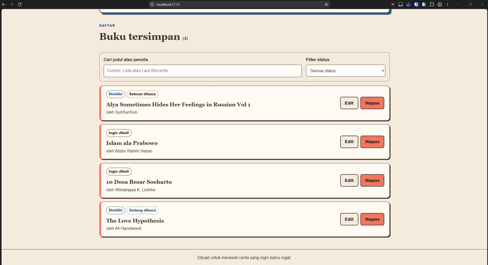
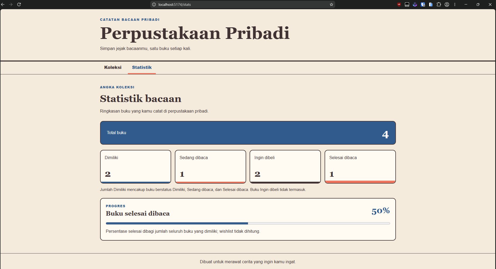
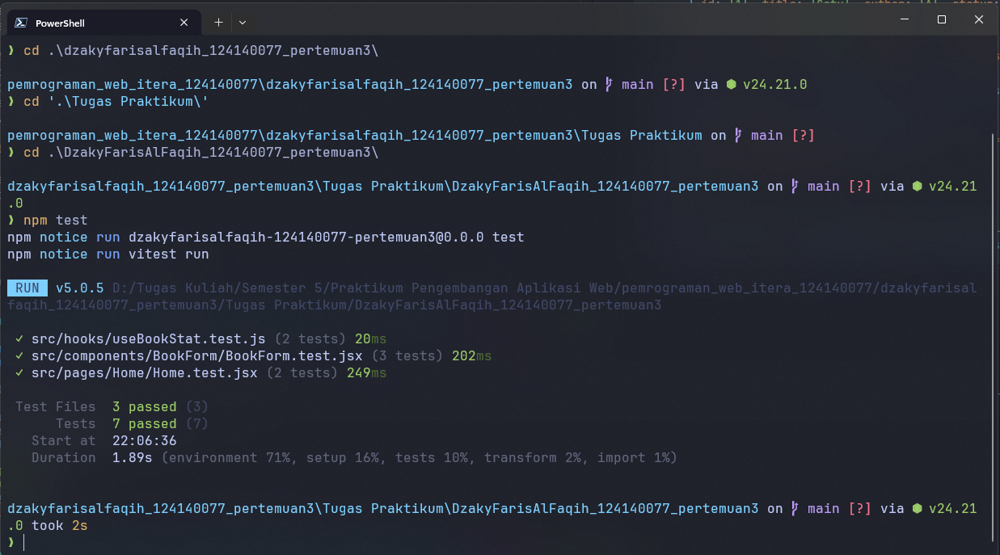

# Manajemen Buku Pribadi

Aplikasi React untuk mencatat buku yang dimiliki, sedang dibaca, ingin dibeli, atau selesai dibaca. Data disimpan di browser menggunakan localStorage.

## Fitur

- Tambah, edit, dan hapus buku.
- Validasi judul dan penulis.
- Cari berdasarkan judul atau penulis dan filter menurut status.
- Statistik total dan jumlah per status.
- Buku berstatus Sedang dibaca dan Selesai dibaca juga dihitung sebagai Dimiliki; wishlist tidak termasuk.
- Persentase selesai dihitung dari buku Selesai dibaca dibagi seluruh buku Dimiliki (termasuk yang sedang dibaca).
- Data bertahan setelah halaman dimuat ulang.

## Instalasi dan menjalankan

Pastikan Node.js sudah terpasang, lalu jalankan dari folder proyek:

```powershell
npm install
npm run dev
```

Buka URL lokal yang ditampilkan Vite.

## Menjalankan test dan pemeriksaan

```powershell
npm test
```

## Teknologi React

- Functional components dan Hooks (`useState`, `useEffect`).
- Context API untuk state koleksi bersama.
- React Router untuk halaman Koleksi dan Statistik.
- Custom hooks `useLocalStorage` dan `useBookStats`.
- PropTypes untuk pemeriksaan props komponen.
- Vitest dan React Testing Library untuk unit test.

## Screenshot


### Halaman koleksi



### Halaman koleksi - Buku tersimpan



### Halaman statistik



### Hasil unit test




