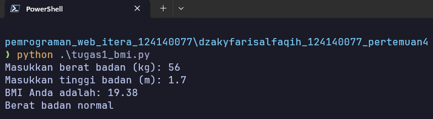
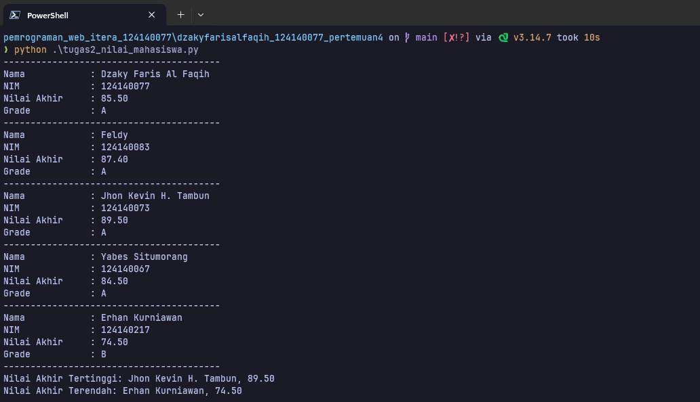
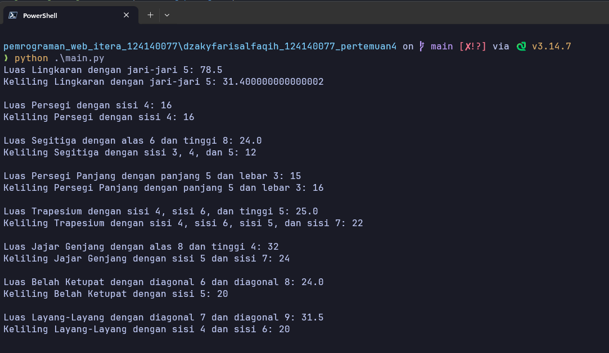

# Tugas Praktikum Pertemuan 4

## Identitas Mahasiswa

- **Nama:** Dzaky Faris Al Faqih
- **NIM:** 124140077

## Deskripsi Program

### Soal 1 — Menghitung BMI

File `tugas1_bmi.py` meminta input berat badan dalam kilogram dan tinggi badan dalam meter. Program menghitung BMI, menampilkan hasilnya, lalu memberi kategori berat badan.

### Soal 2 — Data Nilai Mahasiswa

File `tugas2_nilai_mahasiswa.py` menyimpan data mahasiswa beserta nilai UTS, UAS, dan tugas. Program menghitung nilai akhir dan grade, menampilkan data setiap mahasiswa, lalu mencari mahasiswa dengan nilai tertinggi dan terendah.

### Soal 3 — Modul Operasi Matematika

File `math_operations.py` berisi fungsi untuk menghitung luas dan keliling beberapa bangun datar. File `main.py` mengimpor dan menjalankan fungsi-fungsi tersebut dengan contoh ukuran.

### Program Latihan

Folder `Latihan` berisi program latihan berikut:

- `latihan1.py`: latihan dasar Python.
- `latihan2_suhu.py`: konversi suhu.
- `latihan3_tebak.py`: permainan tebak angka.
- `latihan4_validasi.py`: validasi password.
- `latihan5_kontak.py`: mengelola data kontak sederhana.
- `password_gen.py` dan `main.py`: membuat dan menampilkan password acak.

## Cara Menjalankan

Buka terminal di folder proyek, lalu masuk ke folder pertemuan 4:

```powershell
cd "dzakyfarisalfaqih_124140077_pertemuan4"
```

Jalankan program tugas:

```powershell
python tugas1_bmi.py
python tugas2_nilai_mahasiswa.py
python main.py
```

Saat menjalankan `tugas1_bmi.py`, masukkan berat badan dalam kilogram dan tinggi badan dalam meter, misalnya `60` dan `1.65`.

Jalankan program latihan dari folder pertemuan 4:

```powershell
python Latihan/latihan1.py
python Latihan/latihan2_suhu.py
python Latihan/latihan3_tebak.py
python Latihan/latihan4_validasi.py
python Latihan/latihan5_kontak.py
python Latihan/main.py
```

## Screenshot Hasil Eksekusi


- hasil menjalankan `tugas1_bmi.py`.


- hasil menjalankan `tugas2_nilai_mahasiswa.py`.


- hasil menjalankan `main.py`.