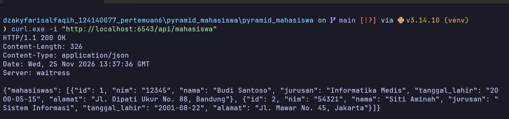
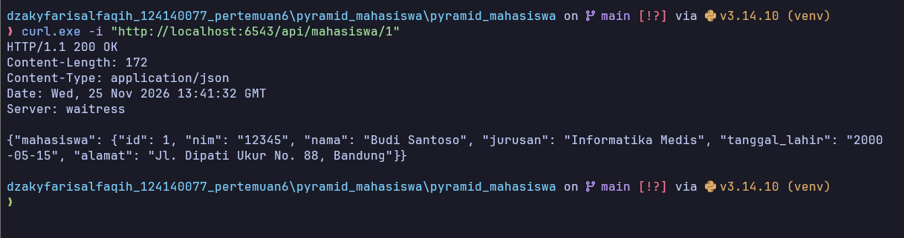
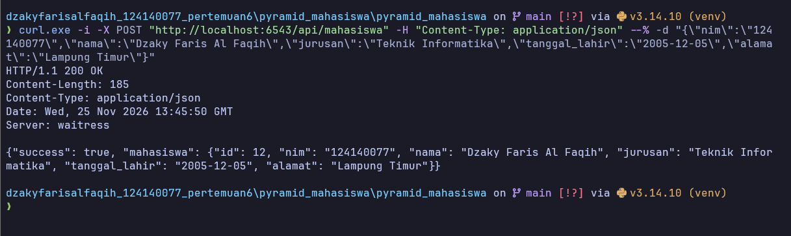
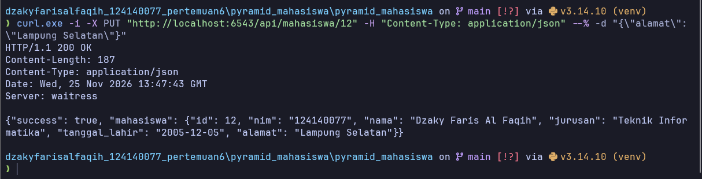
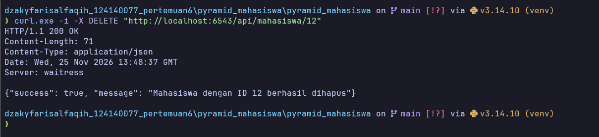
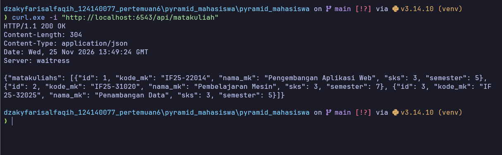
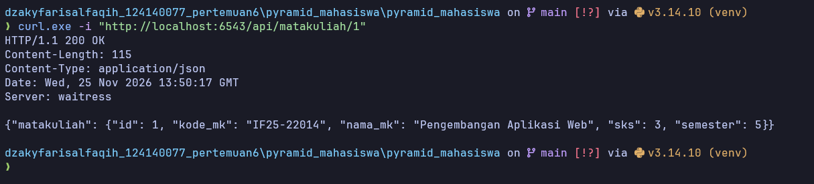
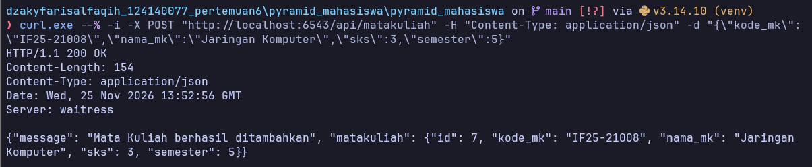
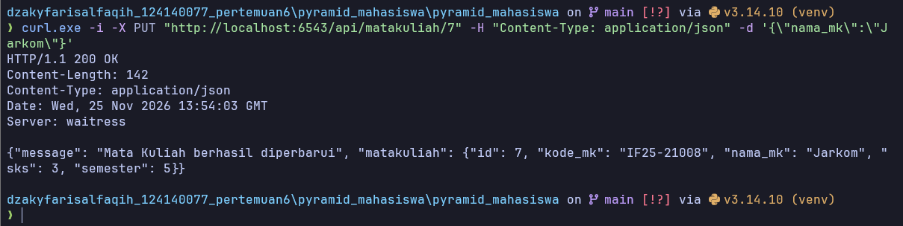
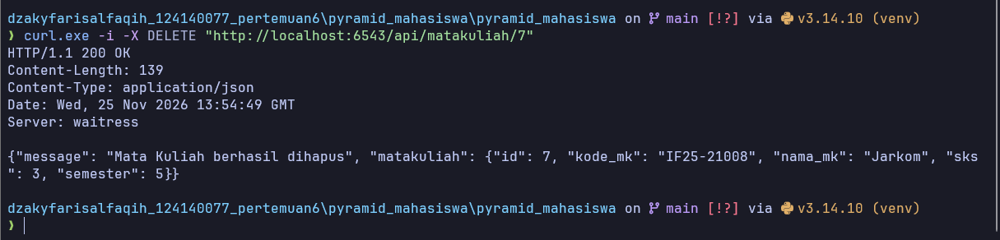

## Identitas

- Nama: Dzaky Faris Alfaqih
- NIM: 124140077
- Praktikum: Pengembangan Aplikasi Web RB Pertemuan 6

## Deskripsi

Aplikasi REST API berbasis Pyramid dan SQLAlchemy untuk mengelola data mahasiswa dan mata kuliah. Data disimpan di PostgreSQL. Endpoint mengembalikan JSON.

## Instalasi

Jalankan perintah dari direktori proyek yang berisi `development.ini`:

```powershell
python -m venv venv
venv\Scripts\Activate.ps1
python -m pip install --upgrade pip
pip install -e .
```

Pastikan PostgreSQL berjalan dan database serta user sesuai dengan connection string `sqlalchemy.url` di `development.ini` sudah tersedia. Sesuaikan kredensial lokal sebelum menjalankan aplikasi.

## Migrasi database

Dengan virtual environment aktif dan dari direktori yang sama:

```powershell
alembic -c development.ini upgrade head
```

Untuk membuat migrasi setelah mengubah model:

```powershell
alembic -c development.ini revision --autogenerate -m "deskripsi perubahan"
```

    Periksa file migrasi yang dihasilkan sebelum menjalankan `upgrade head`.

## Menjalankan server

```powershell
pserve development.ini
```

Server development berjalan di `http://localhost:6543`.

## Endpoint

| Resource | Method | URL | Kegunaan |
|---|---|---|---|
| Mahasiswa | GET | `/api/mahasiswa` | Daftar mahasiswa |
| Mahasiswa | GET | `/api/mahasiswa/{id}` | Detail mahasiswa |
| Mahasiswa | POST | `/api/mahasiswa` | Tambah mahasiswa |
| Mahasiswa | PUT | `/api/mahasiswa/{id}` | Ubah mahasiswa |
| Mahasiswa | DELETE | `/api/mahasiswa/{id}` | Hapus mahasiswa |
| Mata Kuliah | GET | `/api/matakuliah` | Daftar mata kuliah |
| Mata Kuliah | GET | `/api/matakuliah/{id}` | Detail mata kuliah |
| Mata Kuliah | POST | `/api/matakuliah` | Tambah mata kuliah |
| Mata Kuliah | PUT | `/api/matakuliah/{id}` | Ubah mata kuliah |
| Mata Kuliah | DELETE | `/api/matakuliah/{id}` | Hapus mata kuliah |

## Contoh cURL

```powershell
# Daftar dan detail
curl.exe http://localhost:6543/api/mahasiswa
curl.exe http://localhost:6543/api/mahasiswa/1
curl.exe http://localhost:6543/api/matakuliah
curl.exe http://localhost:6543/api/matakuliah/1

# Tambah
curl.exe -X POST http://localhost:6543/api/mahasiswa -H "Content-Type: application/json" -d '{"nim":"124140077","nama":"Dzaky Faris Al Faqih","jurusan":"Informatika Medis","tanggal_lahir":"2005-12-05","alamat":"Bandar Lampung"}'
curl.exe -X POST http://localhost:6543/api/matakuliah -H "Content-Type: application/json" -d '{"kode_mk":"IF25-22016","nama_mk":"Inteligensi Buatan","sks":3,"semester":5}'

# Ubah (ganti ID dengan ID dari respons POST)
curl.exe -X PUT http://localhost:6543/api/mahasiswa/3 -H "Content-Type: application/json" -d '{"nama":"Nama yang Diperbarui"}'
curl.exe -X PUT http://localhost:6543/api/matakuliah/4 -H "Content-Type: application/json" -d '{"nama_mk":"Nama Mata Kuliah yang Diperbarui"}'

# Hapus data uji setelah selesai
curl.exe -X DELETE http://localhost:6543/api/mahasiswa/3
curl.exe -X DELETE http://localhost:6543/api/matakuliah/4
```

Jalankan POST, PUT, lalu DELETE sebagai satu rangkaian memakai ID yang dikembalikan POST. Contoh NIM dan kode mata kuliah harus belum dipakai di database.

## Bukti pengujian

Pengujian cURL dilakukan pada server lokal port `6544`. Semua endpoint daftar, detail, tambah, ubah, dan hapus untuk mahasiswa serta mata kuliah mengembalikan HTTP 200. Data uji `ZZTEST077` dihapus setelah pengujian. Hasil teks lengkap dan screenshot:

| No. | Endpoint | Metode | Screenshot |
|---:|---|---|---|
| 1 | /api/mahasiswa | GET |  |
| 2 | /api/mahasiswa/{id} | GET |  |
| 3 | /api/mahasiswa | POST |  |
| 4 | /api/mahasiswa/{id} | PUT |  |
| 5 | /api/mahasiswa/{id} | DELETE |  |
| 6 | /api/matakuliah | GET |  |
| 7 | /api/matakuliah/{id} | GET |  |
| 8 | /api/matakuliah | POST |  |
| 9 | /api/matakuliah/{id} | PUT |  |
| 10 | /api/matakuliah/{id} | DELETE |  |
